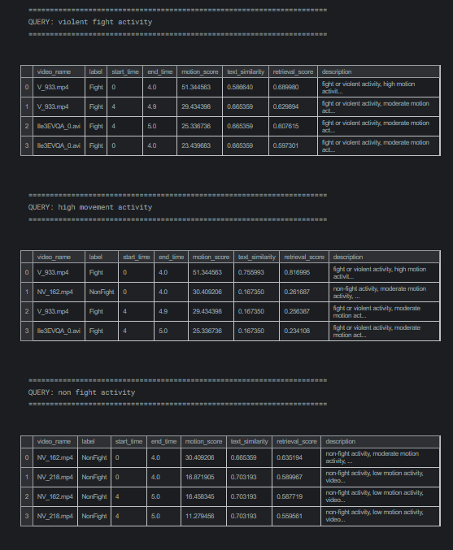
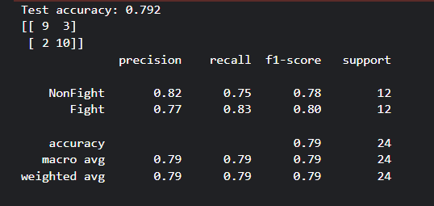

# Forensic Video Retrieval (CPU Prototype)

This is a small project where I try to search through surveillance (CCTV)
videos using normal English sentences, like "violent fight activity", and
get back the exact clips that match, with timestamps. I built it as a
prototype to learn how video search and basic video analysis work, and it
runs on CPU only (no GPU needed).

## What the project does

Imagine a security person has hours of footage and wants to find only the
fight scenes. Watching everything takes forever, so this project:

1. Cuts every video into 4-second segments, each with a start and end time
2. Measures how much movement happens in each segment
3. Writes a short text description for each segment
4. Lets you type a question and finds the best matching segments
5. Cuts those segments out as small evidence clips you can play

## How it works (step by step)

1. **Loading videos:** I picked a few Fight and NonFight videos from the
   UVFD dataset on Kaggle and read their details (fps, duration, size)
   using OpenCV.
2. **Segmenting:** Each video is split into 4-second pieces so I can point
   to an exact time where something happens.
3. **Motion score:** For each segment I take a few frames, shrink them,
   turn them grey, and check how much they differ from each other (frame
   differencing). More difference means more movement. I then scale the
   scores between 0 and 1.
4. **Descriptions:** Each segment gets a text description like "fight,
   high motion activity, video segment from 0.0 to 4.0 seconds".
5. **Search:** I used TF-IDF and cosine similarity (from scikit-learn) to
   compare the user's question with the descriptions. The final ranking is
   75% text match and 25% motion score.
6. **Improved search:** If the question has words like "fight" or
   "violent", it only looks at Fight segments. If it has words like
   "normal" or "peaceful", it only looks at NonFight segments. It also
   throws away broken or blank frames.
7. **Evidence clips:** ffmpeg cuts the matching parts out of the original
   videos so I can watch them.
8. **Chat-style agent:** A simple agent answers questions like "find
   violent activity" and can answer follow-ups like "which is the
   strongest result?". It prints the video name, timestamps and relevance.

## Results

Here is an example of the agent answering a query:

## Evaluation (how well does it actually work?)

My search demo has a problem (explained in the limitations), so I wanted
a proper test of how useful the motion feature really is by itself. For
this I trained a logistic regression model using only motion numbers from
each video (average, maximum, and standard deviation of its segment motion
scores), without using the labels in any text.

- **Data:** 40 videos per class from UVFD (random seed 42)
- **Split:** 70% training, 30% testing (24 test videos, balanced)

| Metric | Value |
|---|---|
| Accuracy | 79.2% |
| Fight precision | 0.77 |
| Fight recall | 0.83 |
| Fight F1 | 0.80 |

Confusion matrix (rows = real class, columns = predicted class):

|  | Predicted NonFight | Predicted Fight |
|---|---|---|
| **Real NonFight** | 9 | 3 |
| **Real Fight** | 2 | 10 |

So out of 24 videos it got 19 right. It found 10 of the 12 fights, but it
also wrongly marked 3 normal videos as fights.

**Things to keep in mind:** the test set is small (only 24 videos), so
this accuracy number can easily change if I pick different videos. Some
videos had decoding warnings (interlaced format), so a few frames were
skipped. Also, motion alone can't tell the difference between a fight and
other fast movement like sports or crowds.

## Limitations (being honest)

- The descriptions in my search demo are built using the dataset's
  Fight/NonFight labels. That means the search is not really "seeing" the
  fight in the pixels, it is partly using the answer that is already
  given. The evaluation section above is the more honest measure of what
  the video itself tells us.
- I only tested on a small number of videos.
- The motion score is very simple, so it can't understand what is
  actually happening in a scene.

## What I want to improve next

- Use a pretrained vision model (like CLIP) so the search understands the
  actual video frames instead of just motion and labels
- Test on many more videos
- Remove the labels from the descriptions

## How to run it

1. Open the Kaggle notebook: https://www.kaggle.com/code/nysasaini/forensic-video-retrieval
2. Make sure the UVFD dataset is added in the Input section
3. Click Run All

Python libraries used: OpenCV, pandas, numpy, scikit-learn, matplotlib,
and ffmpeg. They are listed in `requirements.txt`.

The dataset videos are **not** included in this repo because they belong
to the dataset authors.

## Credits

I did vibecoding and used AI tools (Claude and ChatGPT) to guide me through this project and
to help me write and understand the code. After that I ran it myself on
Kaggle, tested it, added the accuracy evaluation, and edited things to
understand how each part works. The dataset is UVFD from Kaggle.
