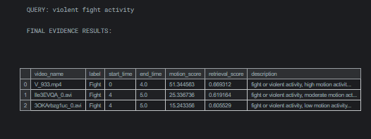

# Forensic Video Retrieval (CPU Prototype)

A pipeline that splits surveillance videos into timestamped segments,
extracts motion features, and lets you search them with natural-language
queries, returning evidence clips.

## How it works
1. Split videos into 4-second segments (OpenCV)
2. Compute a motion score per segment using frame differencing
3. Build text descriptions and index them with TF-IDF
4. Rank segments by text similarity + motion, then cut clips with ffmpeg

## Results

## Run it
Kaggle notebook: [paste your Kaggle notebook link here]
Dataset: UVFD (Kaggle) - videos are not included in this repo.

## Limitations
- Descriptions use the dataset's Fight/NonFight labels, so it
  does not detect fights from pixels.
- Tested on only 6 videos.

## Credits
[Name the original source of the code, and what you changed.]
