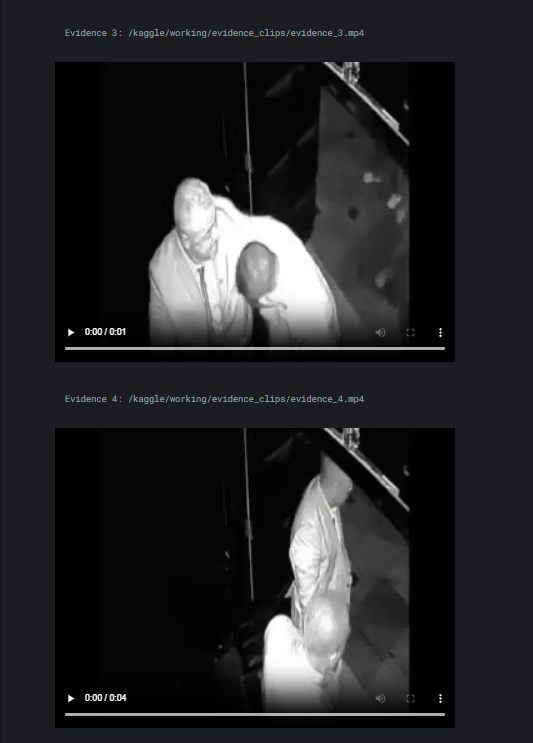

# Forensic Video Retrieval (CPU Prototype)

A pipeline that splits surveillance videos into timestamped segments,
extracts motion features, and lets you search them with natural-language
queries, returning evidence clips.

## How it works
1. Split videos into 4-second segments (OpenCV)
2. Compute a motion score per segment using frame differencing
3. Build text descriptions and index them with TF-IDF
4. Rank segments by text similarity + motion, then cut clips with ffmpeg

## Results

## Run it
Kaggle notebook: [(https://www.kaggle.com/code/nysasaini/forensic-video-retrieval)]
Dataset: UVFD (Kaggle) - videos are not included in this repo.

## Limitations
- Descriptions use the dataset's Fight/NonFight labels, so it
  does not detect fights from pixels.
- Tested on only 6 videos.

## Evaluation

To measure what the motion feature can do on its own, without using the
dataset labels in the text descriptions, I trained a logistic regression
classifier on per-video motion statistics (mean, max, and standard
deviation of segment motion scores).

- **Data:** 40 videos per class sampled from UVFD (random seed 42)
- **Split:** 70% train / 30% test (24 held-out videos, stratified)
- **Results:**

| Metric | Value |
|---|---|
| Accuracy | 79.2% |
| Fight precision | 0.77 |
| Fight recall | 0.83 |
| Fight F1 | 0.80 |

Confusion matrix (rows = true, columns = predicted):

|  | Pred NonFight | Pred Fight |
|---|---|---|
| **True NonFight** | 9 | 3 |
| **True Fight** | 2 | 10 |

**Caveats:** the test set is small (24 videos), so the estimate is noisy.
Some videos produced decoding warnings (interlaced format), which dropped
a few frames. Motion alone cannot separate fights from other high-movement
activity, so a pretrained vision model would be the next step.

## Credits
[I have used ai tools like claude and chatgpt to guide me through this project and help me vibecode it throughout and is further edited by me.]
